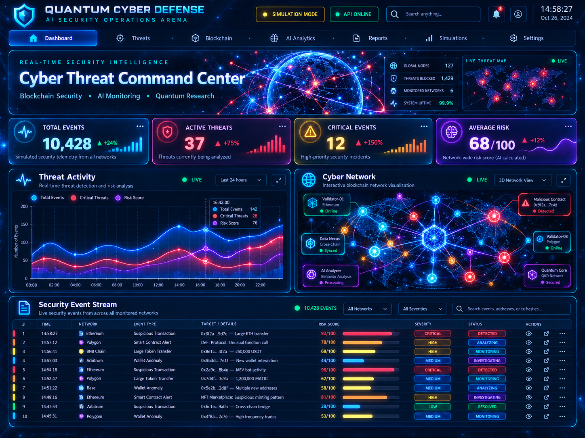

# Quantum Cyber Defense Arena



## Research Platform Overview

Quantum Cyber Defense Arena combines **AI-driven anomaly detection**, **quantum-inspired security research**, **hybrid decision-making**, and **interactive 3D network visualization** in one unified research platform.

**🧠 AI Detection** — Threat scoring, anomaly monitoring and incident investigation.

**⚛️ Quantum Research** — Quantum-inspired simulations and benchmark validation.

**🔗 Hybrid Fusion** — Classical and quantum-inspired signals combined for decision support.

**🌐 Interactive 3D** — Animated cyber network visualization and synthetic dashboard telemetry.


---

### Full Interactive 3D Dashboard

[](https://quantum-cyber-defense-live-demo.vercel.app)

**[▶ OPEN FULL INTERACTIVE 3D DASHBOARD — VERCEL](https://quantum-cyber-defense-live-demo.vercel.app)**

*Click the dashboard image to launch the complete interactive React/Three.js platform on Vercel. The standalone demonstration uses synthetic telemetry, not live threat intelligence.*


**AI-Powered Cybersecurity Research | Quantum Simulation | Hybrid Threat Detection | Multi-Agent Investigation**

Quantum Cyber Defense Arena is a research-oriented cybersecurity platform combining classical machine learning, quantum-inspired anomaly detection, hybrid decision-making, autonomous investigation workflows, and interactive security dashboards.

The project explores how different detection architectures perform under synthetic security simulations and on labeled blockchain transaction data.

**Release:** V14.0 – Professional Research Prototype  
**Status:** Research and demonstration environment  
**Technology:** Python, FastAPI, React, TypeScript, Qiskit, scikit-learn

---

## 1. Project Overview

Quantum Cyber Defense Arena brings several experimental cybersecurity components into a unified research platform.

Core capabilities include:

- Simulated blockchain security monitoring
- Classical AI-based anomaly detection
- Quantum state-fidelity anomaly detection using classical simulation
- Hybrid quantum-classical decision policies
- Autonomous incident investigation workflows
- Multi-agent cybersecurity research
- Statistical research validation
- Robustness and stress testing
- Evaluation using the real Elliptic Bitcoin Dataset
- Interactive 3D network visualization and research dashboards

The system is designed for research, learning, experimentation, and technical demonstration.

It is not a production-ready intrusion detection system.

## 2. System Architecture

```text
Quantum Cyber Defense Arena
|
|-- FastAPI Backend
|   |-- Threat Simulation
|   |-- Classical AI Detection
|   |-- Quantum Anomaly Detection
|   |-- Hybrid Fusion Engine
|   |-- Autonomous Investigation
|   |-- Multi-Agent Cyber Defense
|   |-- Research Validation APIs
|
|-- React / TypeScript Frontend
|   |-- Security Operations Dashboard
|   |-- Cyber Network 3D Visualization
|   |-- AI Threat Intelligence
|   |-- Quantum Research Panel
|   |-- Hybrid Fusion Panel
|   |-- Autonomous Investigation Panel
|   |-- Multi-Agent Panel
|   |-- Research Validation Dashboard
|
|-- Research Validation
|   |-- V11: Synthetic Benchmarking
|   |-- V12: Robustness Testing
|   |-- V13: Real Blockchain Data Evaluation
|
|-- Release
    |-- V14: Research Audit and Documentation
```

## 3. Classical AI Detection

The classical anomaly-detection research uses Isolation Forest and numerical transaction or security features.

The system evaluates detection performance using:

- Precision
- Recall
- F1-score
- Accuracy
- False-positive rate
- Confusion matrices

In later experiments, supervised baseline models were introduced to determine whether the Elliptic dataset contains useful discriminatory information.

## 4. Quantum Anomaly Detection

The quantum research component uses a Qiskit-based state-fidelity simulation to evaluate anomaly scores.

The experiments investigate whether quantum-state representations can provide useful anomaly signals.

**Important:** The quantum computations are simulated on classical hardware. The project does not demonstrate a computational speedup from quantum hardware.

## 5. Hybrid Quantum AI Fusion

The Hybrid Fusion research combines outputs from classical and quantum-based anomaly detectors.

The experimental decision policies include:

- Agreement-based classification
- REVIEW decisions when detectors disagree
- Logical AND fusion
- Logical OR fusion

The project evaluates the trade-offs between anomaly detection, false positives, and manual review requirements.

Hybrid fusion is experimental and should not be interpreted as a validated production security solution.

## 6. Multi-Agent Cyber Defense

The platform also includes research components for multi-agent investigation and cybersecurity decision support.

These modules explore autonomous workflows for interpreting simulated security events, coordinating investigations, and presenting findings in the dashboard.

## 7. V11 – Synthetic Research Benchmark

The extended benchmark evaluated classical, quantum-simulated, and hybrid detection across 30 reproducible synthetic runs.

| Model | Mean F1-score |
|---|---:|
| Classical AI | 73.57% |
| Quantum AI | 93.91% |
| Hybrid Fusion | **94.06%** |

The statistical analysis used paired comparisons and Holm multiple-testing correction.

These results describe performance on the chosen synthetic distributions. They do not establish real-world effectiveness or quantum computational advantage.

## 8. V12 – Robustness and Stress Testing

The V12 experiments investigated how the detection models respond to changing synthetic conditions:

- Baseline distributions
- Noisy observations
- Rare anomalies
- Overlapping anomaly distributions

Detailed results are stored in:

`research_validation/v12/robustness_benchmark_v12_results.json`

## 9. V13 – Real Blockchain Dataset Validation

The V13 research uses the **Elliptic Bitcoin Dataset**, containing labeled Bitcoin transactions and anonymized numerical features.

The dataset was prepared using a chronological split, retaining 165 original numerical features and excluding transactions with unknown labels from supervised evaluation.

### V13.2 – Initial Real-Data Evaluation

| Model | F1-score |
|---|---:|
| Classical AI | 0.00% |
| Quantum AI | 12.19% |
| Hybrid Fusion | 0.00% |

The substantial decline from synthetic benchmark performance revealed limitations in model generalization, feature adaptation, and fixed decision thresholds.

### V13.3 – Model Calibration

Following calibration, the evaluated detection policies still failed to identify the 32 labeled illicit transactions in the sampled test set.

| Model | F1-score |
|---|---:|
| Classical AI | 0.00% |
| Quantum AI | 0.00% |
| Hybrid AND | 0.00% |
| Hybrid OR | 0.00% |

These findings highlight the need for stronger models and independent validation.

### V13.4 – Supervised Baseline Diagnostics

To investigate whether useful predictive information existed in the Elliptic features, supervised reference models were evaluated separately.

| Model | F1-score | Average Precision |
|---|---:|---:|
| Dummy Baseline | 12.21% | 6.50% |
| Logistic Regression | 24.65% | 19.52% |
| Random Forest | **77.73%** | **79.91%** |

The Random Forest achieved:

- Precision: 82.05%
- Recall: 73.85%
- False-positive rate: 1.12%
- ROC AUC: 0.9218

This is a **supervised classical reference model**, not an improved quantum detector.

The test period had already been examined during earlier experiments. Therefore, these results remain exploratory rather than a fully independent final validation.

## 10. V14 – Professional Research Release

The V14 release audit checks:

- Project source-file presence
- Python syntax validity
- Research JSON files
- Previously generated benchmark results
- Git repository metadata
- Research report generation

Additional checks performed during release preparation:

- React production build completed successfully
- FastAPI research status endpoint returned HTTP 200

The audit does not replace automated integration testing, dependency security scanning, independent benchmark reproduction, or deployment verification.

## 11. Installation

### Requirements

- Python with project-compatible dependencies
- Node.js and npm
- A supported web browser
- Git

The development environment used Python 3.11 for key project components.

### Backend

From the project root, use the configured Python environment to run:

```powershell
.\.venv\Scripts\python.exe main.py
```

The FastAPI backend is expected at:

`http://127.0.0.1:8000`

### Frontend

In a separate terminal:

```powershell
cd frontend
npm install
npm run dev
```

The development dashboard is expected at:

`http://127.0.0.1:5173`

Actual startup behavior depends on the local environment and installed dependencies.

## 12. Research Reproducibility

The research programs and their generated JSON outputs are organized under:

`research_validation/`

Selected entry points:

```text
research_validation/v11/benchmark_v11.py
research_validation/v11/benchmark_v11_2.py
research_validation/v11/research_analysis_v11_3.py
research_validation/v12/robustness_benchmark_v12.py
research_validation/v13/elliptic_prepare_v13.py
research_validation/v13/elliptic_validation_v13_2.py
research_validation/v13/model_calibration_v13_3.py
research_validation/v13/model_diagnostic_v13_4.py
release/v14/release_validation_v14.py
```

The original large external dataset files are not included in the documented Git commits.

The Elliptic dataset must be obtained separately from a legitimate source, subject to its applicable licensing and access terms.

## V15 — Autonomous Quantum AI Cyber Defense (Completed)

**Status:** V15.1–V15.5 implemented and committed to the `feature/cyber-network-v2` branch. Research-simulation validation: **PASS (0 failed checks)**. Production readiness has **not** been established.

The V15 development cycle extends the earlier V3–V14 research platform without replacing existing modules.

| Release | Module | What it does |
| --- | --- | --- |
| **V15.1** | Intelligent Threat Orchestrator | Combines synthetic Classical AI and Quantum AI score inputs using an explainable hybrid policy; assigns risk and priorities. |
| **V15.2** | Multi-Agent Decision Engine | Runs three sequential, deterministic rule-based assessment roles: Threat Analysis, Investigation, and Decision. |
| **V15.3** | Autonomous Response Simulation | Produces priority-aware simulated response plans, human-approval requirements, and local audit trails; performs no external security actions. |
| **V15.4** | Live Command Center | Adds an animated React dashboard panel showing saved V15.1–V15.3 JSON results, event playback, risk distribution, decisions, and proposed response states. |
| **V15.5** | Validation & Release | Checks saved JSON structure, cross-version event consistency, decision/response rules, safety conditions, and static frontend integration. Result: **PASS**. |

### V15 source files

```text
research_validation/v15/
  threat_orchestrator_v15_1.py
  threat_orchestrator_v15_1_results.json
  multi_agent_decision_v15_2.py
  multi_agent_decision_v15_2_results.json
  autonomous_response_v15_3.py
  autonomous_response_v15_3_results.json
  validation_release_v15_5.py
  validation_release_v15_5_results.json

frontend/src/components/LiveCommandCenterV15_4.tsx
frontend/public/v15/
  threat_orchestrator_v15_1_results.json
  multi_agent_decision_v15_2_results.json
  autonomous_response_v15_3_results.json
```

### Run V15 locally

From the repository root, run the research scripts in order:

```powershell
python research_validation/v15/threat_orchestrator_v15_1.py
python research_validation/v15/multi_agent_decision_v15_2.py
python research_validation/v15/autonomous_response_v15_3.py
python research_validation/v15/validation_release_v15_5.py
```

Start the original backend and Vite frontend in separate terminals (with dependencies installed). The V15.4 React panel is integrated into `frontend/src/App.tsx` and reads JSON exports from `frontend/public/v15/`. When the JSON files are missing, the panel explicitly switches to illustrative demo data. Exported JSON files are historical snapshots: animated playback is **not** a live model-inference or blockchain stream.

**Scientific and safety limitations:** V15.1 uses synthetic model scores; V15.2 is a deterministic rule-based pipeline rather than independent LLM agents; V15.3 proposes or simulates responses but never applies real firewall, wallet, blockchain, or network changes. The V15.5 PASS verifies saved simulation data and static integration, not real-world detection accuracy, quantum advantage, production security, live API health, browser end-to-end operation, or a Vercel deployment.

---

## 13. Research Limitations

- The original synthetic benchmark results do not generalize reliably to the tested real dataset.
- The quantum component relies on classical quantum simulation.
- The real-data quantum experiments use PCA-derived coordinates.
- The supervised Random Forest baseline is not directly comparable to the original anomaly detectors as proof of quantum or hybrid improvement.
- Real-data thresholds, class imbalance, feature semantics, and dataset shifts materially affect results.
- The final historical test period was previously inspected.
- No production security certification has been performed.
- The project does not claim verified quantum computational advantage.

## 14. Research Purpose

Quantum Cyber Defense Arena demonstrates an integrated research workflow spanning machine learning, quantum simulation, hybrid systems, cybersecurity analytics, statistical validation, and interactive software development.

The project represents the completion of the planned V14 research-prototype development cycle.

**Research prototype — not a certified production cybersecurity system.**